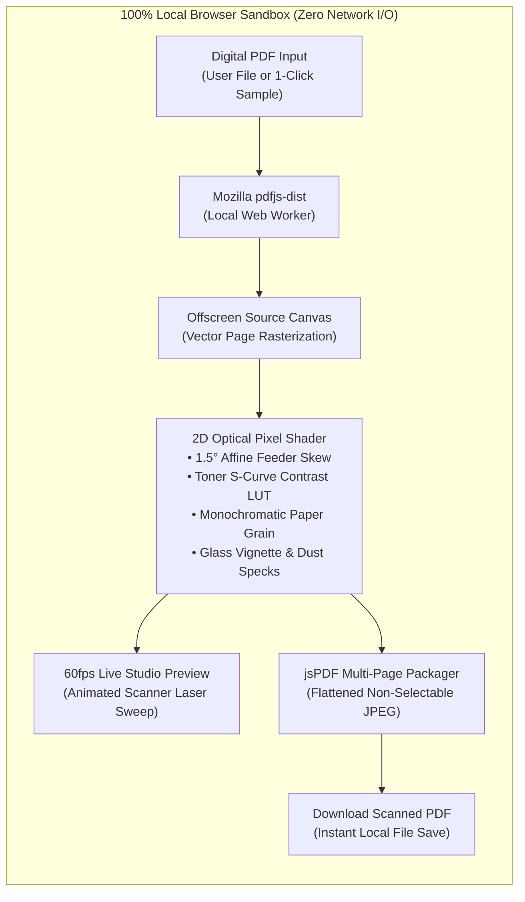

<div align="center">

# 📄 PDFtoScan

### Make Any PDF Look Like a Realistic Physical Scan Online — 100% Client-Side

[](https://pdftoscan.github.io/)
[](https://astro.build/)
[](https://react.dev/)
[](https://tailwindcss.com/)
[](https://pdftoscan.github.io/)
[](./LICENSE)
[](https://ko-fi.com/kishara)

[**Launch Live Studio (`https://pdftoscan.github.io/`)**](https://pdftoscan.github.io/) · [**Report a Bug**](https://github.com/pdftoscan/pdftoscan.github.io/issues) · [**Support the Developer**](https://ko-fi.com/kishara)

</div>

---

## 📖 Overview

**PDFtoScan** ([`https://pdftoscan.github.io/`](https://pdftoscan.github.io/)) is a privacy-first, 100% client-side web application and installable Progressive Web App (PWA) engineered with **Astro** and **React Islands**. It transforms clean vector PDFs into authentic, uneditable physical scan documents directly inside the user's browser without ever uploading a single byte to an external server.

Whether you need to blend a pasted digital signature into a contract, flatten selectable vector text layers into tamper-resistant raster pages, or satisfy legacy administrative portals that require a scanned document, **PDFtoScan** simulates an optical flatbed scanner in real time at **60fps**.

---

## ✨ Flagship Capabilities

| Capability | Engineering Implementation |
| :--- | :--- |
| **🔒 100% Client-Side Zero-Knowledge Privacy** | Powered locally by Mozilla `pdfjs-dist` (`Web Worker`) + HTML5 `<canvas>` + `jsPDF`. Documents never leave the device's RAM. Works completely offline after page load. |
| **⚡ Real-Time 60fps Flatbed Scanner Studio** | Interactive page preview with an animated **Warm Vintage Gold (`#E5CD82`)** and **Soft Parchment (`#FFF2B4`)** optical scanner light beam (`cubic-bezier(0.22, 1, 0.36, 1)`). |
| **🎛️ 4 Hardware-Calibrated Scan Presets** | One-click profiles for **Office Photocopier B&W**, **Clean Grayscale Scan**, **Mobile CamScanner Color** (signature & stamp safe), and **Vintage Heavy Fax**. |
| **📐 4 Oversized Optical Sliders** | Real-time control over **Page Tilt Angle** (`0.0°–3.0°`, default `1.5°`), **Noise & Paper Grain** (`0%–100%`, default `28%`), **Contrast & Ink Darkness** (`100%–200%`, default `135%`), and **Scan Resolution DPI** (`100–300 DPI`, default `150 DPI`). |
| **🧪 Built-in 1-Click Sample Contract PDF** | Generates a 2-page Master Services Agreement on the fly (complete with blue ink signatures and an official red circular stamp) so users can test the studio immediately. |
| **♿ Oversized Ergonomics & WCAG AAA Contrast** | Giant typography, `56px+` primary touch targets, `32px` custom slider thumbs, explicit ARIA slider attributes, and a responsive mobile/tablet toggle drawer (`< 768px`). |
| **📲 Installable Offline PWA** | Full Workbox Service Worker precaching (`@vite-pwa/astro`) with native `beforeinstallprompt` integration and an iOS Safari "Add to Home Screen" guide modal. |
| **🌍 8-Language Static Localization (`i18n`)** | Dedicated static subpath routes, full UI/FAQ translations, and complete `hreflang` + XML sitemap clusters across 8 global languages. |

---

## 🏗️ System Architecture & Optical Shader Pipeline



### How the 2D Optical Pixel Shader Works
1. **Vector Rasterization:** Each page of the input PDF is rendered onto an offscreen HTML5 Canvas at the target DPI scale (`100 DPI` to `300 DPI`).
2. **Deterministic Feeder Skew (`1.5°` Default):** An affine transformation matrix rotates each page around its center with subtle alternating feeder variation so multi-page exports mimic a physical Automatic Document Feeder (ADF).
3. **Photocopier Luminance & Color Modes:**
   - **Photocopier B&W:** Applies a soft S-curve threshold lookup table (LUT) that deepens dark toner while keeping paper backgrounds warm and realistic.
   - **True Grayscale:** Perceptual luminance conversion (`0.299R + 0.587G + 0.114B`) with organic paper texture.
   - **Color Stamp Safe:** Preserves blue ballpoint signatures and red corporate seals under high-contrast scanner lamp exposure.
   - **Warm Parchment:** Tints the paper substrate toward archival cream (`#FAF3DE`).
4. **Paper Fiber Grain & Glass Vignette:** Injects seeded monochromatic noise across every pixel along with a radial flatbed glass shadow and microscopic dust specks.
5. **Memory Sanitization:** Temporary offscreen canvases and PDF worker proxies are immediately destroyed and zeroed (`width = 1; height = 1`) after export.

---

## 🎨 Design System & Color Palette

| Color Token | Hex Code | Light Mode Role (Default) | Dark Mode Role (`class="dark"`) |
| :--- | :---: | :--- | :--- |
| **Deep Forest Pine** | `#15370D` | Primary headings, body text, structural borders, primary CTA buttons | Primary studio background & high-contrast CTA text |
| **Muted Sage Olive** | `#728E6D` | Secondary labels, slider hints, subtle dividers | Card borders & secondary structural accents |
| **Warm Vintage Gold** | `#E5CD82` | Slider tracks, active preset rings, 60fps scanner laser beam | Primary CTA buttons, active badges, scanner laser beam |
| **Soft Parchment Cream** | `#FFF2B4` | Elevated workspace cards, dropzone surface, primary button text | Primary headings & high-contrast body typography |
| **Warm Alabaster Cream** | `#FFFDF5` | Crisp studio page background | High-contrast surface accent |
| **Dark Sage-Pine Surface** | `#1E4615` | Primary button hover state | Elevated studio cards & control panels |

---

## 🌍 Internationalization (`i18n`) & Static Routes

Every language route is pre-rendered at build time with localized metadata, Open Graph tags, `BreadcrumbList` / `HowTo` / `FAQPage` JSON-LD schemas, and bidirectional `hreflang` links:

| Locale | Badge | Language | Static Route | Canonical Production URL |
| :---: | :---: | :--- | :---: | :--- |
| `en` | `US` | **English** (Default) | `/` | <https://pdftoscan.github.io/> |
| `es` | `ES` | **Español** | `/es/` | <https://pdftoscan.github.io/es/> |
| `pt` | `BR` | **Português** | `/pt/` | <https://pdftoscan.github.io/pt/> |
| `de` | `DE` | **Deutsch** | `/de/` | <https://pdftoscan.github.io/de/> |
| `fr` | `FR` | **Français** | `/fr/` | <https://pdftoscan.github.io/fr/> |
| `ja` | `JP` | **日本語** | `/ja/` | <https://pdftoscan.github.io/ja/> |
| `zh` | `CN` | **简体中文** | `/zh/` | <https://pdftoscan.github.io/zh/> |
| `ru` | `RU` | **Русский** | `/ru/` | <https://pdftoscan.github.io/ru/> |

---

## 📂 Project Structure

```text
pdftoscan.github.io/
├── .github/
│   └── workflows/
│       └── deploy.yml                  # Official Astro GitHub Pages CI/CD pipeline
├── public/
│   ├── .nojekyll                       # Prevents GitHub Pages Jekyll from stripping _astro/
│   ├── favicon.svg                     # Vector brand icon & PWA maskable icon
│   ├── og-image.svg                    # 1200x630 Open Graph & Twitter social card
│   ├── pdf.worker.min.js               # Local Mozilla PDF.js Web Worker (precached by PWA)
│   └── robots.txt                      # Crawler directives + Sitemap index pointer
├── src/
│   ├── components/
│   │   ├── Navbar.astro                # Sticky header + mobile/tablet toggle drawer + PWA modal
│   │   ├── PdfScannerIsland.tsx        # React Island: PDF.js -> 2D Shader Canvas -> jsPDF
│   │   └── ScannerPageTemplate.astro   # Unified semantic page template & SEO sections
│   ├── i18n/
│   │   └── translations.ts             # Complete 8-language dictionary & SEO metadata
│   ├── layouts/
│   │   └── Layout.astro                # Document shell, GA4, hreflang, Open Graph & JSON-LD
│   └── pages/
│       ├── index.astro                 # English root route (/)
│       ├── de/index.astro              # German route (/de/)
│       ├── es/index.astro              # Spanish route (/es/)
│       ├── fr/index.astro              # French route (/fr/)
│       ├── ja/index.astro              # Japanese route (/ja/)
│       ├── pt/index.astro              # Portuguese route (/pt/)
│       ├── ru/index.astro              # Russian route (/ru/)
│       └── zh/index.astro              # Simplified Chinese route (/zh/)
├── astro.config.mjs                    # Astro + React + Tailwind + Sitemap + VitePWA config
├── tailwind.config.mjs                 # Design system color tokens & custom animations
├── tsconfig.json                       # Strict TypeScript configuration
├── package.json                        # Scripts & dependencies
└── LICENSE                             # MIT License
```

---

## 💻 Local Development & Build Commands

### Prerequisites
- **Node.js** `>= 18.17.1` (Node `20 LTS` or `22+` recommended)
- **npm** `>= 9.x`

### Quick Start

```bash
# 1. Clone the repository
git clone https://github.com/pdftoscan/pdftoscan.github.io.git
cd pdftoscan.github.io

# 2. Install dependencies
npm install

# 3. Start the local Astro development server (http://localhost:4321)
npm run dev

# 4. Build the static production bundle, XML sitemaps, and PWA Service Worker into ./dist
npm run build

# 5. Preview the production build locally
npm run preview
```

---

## 🚀 Deployment & Google Search Console (GSC) Sitemap Setup

### 1. GitHub Pages Deployment
1. Push your code to the `main` branch of `pdftoscan/pdftoscan.github.io`.
2. In your GitHub repository, navigate to **Settings → Pages**.
3. Under **Build and deployment → Source**, select **GitHub Actions**.
4. The workflow in [`.github/workflows/deploy.yml`](./.github/workflows/deploy.yml) will automatically build and publish the site to `https://pdftoscan.github.io/`.

### 2. Submitting the Sitemap to Google Search Console (GSC)
Once deployed, `@astrojs/sitemap` automatically generates two sitemap files at the root of your site:
- **Sitemap Index:** `https://pdftoscan.github.io/sitemap-index.xml`
- **Primary URL Sitemap:** `https://pdftoscan.github.io/sitemap-0.xml`

To submit your sitemap in **Google Search Console**:
1. Open [Google Search Console](https://search.google.com/search-console) and click **Add property**.
2. Choose **URL prefix** and enter `https://pdftoscan.github.io/`.
3. Verify ownership using **Google Analytics** (already pre-installed in `<head>` with ID `G-3DGCQ6Y4J9` — ensure the same Google account has "Edit" permission in GA4) or via an HTML verification file placed in `public/`.
4. In the left sidebar of Google Search Console, click **Sitemaps** (under the *Indexing* section).
5. Under **Add a new sitemap**, enter:
   ```text
   sitemap-index.xml
   ```
6. Click **Submit**. Google will immediately parse `sitemap-index.xml`, discover `sitemap-0.xml`, and queue all 8 localized routes (`/`, `/es/`, `/pt/`, `/de/`, `/fr/`, `/ja/`, `/zh/`, `/ru/`) along with their `xhtml:link hreflang` annotations for indexing.

---

## 💖 Support the Developer

If **PDFtoScan** saves you time, paper, or toner, please consider supporting its ongoing open-source development:

[](https://ko-fi.com/kishara)

👉 [**https://ko-fi.com/kishara**](https://ko-fi.com/kishara)

---

## 📜 License

Distributed under the **MIT License**. See [`LICENSE`](./LICENSE) for full license text.
