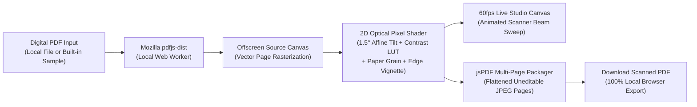

# 📄 PDFtoScan — Make PDF Look Scanned Online Free (100% Client-Side)

[](https://pdftoscan.github.io/)
[](https://astro.build/)
[](https://react.dev/)
[](https://pdftoscan.github.io/)
[](./LICENSE)
[](https://ko-fi.com/kishara)

**Live Production Utility:** [**https://pdftoscan.github.io/**](https://pdftoscan.github.io/)

**PDFtoScan** is an ultra-minimal, 100% client-side Progressive Web App (PWA) built with **Astro** and **React Islands**. It converts clean digital PDFs into authentic, uneditable physical scan documents directly inside the user's browser using Mozilla `pdfjs-dist`, custom HTML5 Canvas 2D pixel shaders, and `jspdf` for multi-page flattened PDF export — with **zero server uploads**.

---

## ✨ Key Features

- **100% Client-Side & Private:** Every byte of your PDF is rendered and processed inside local browser memory (`ArrayBuffer` -> `HTML5 Canvas` -> `Blob`). Nothing ever leaves your device.
- **Real-Time 60fps Flatbed Scanner Studio:** Interactive live preview with a smooth glowing **Warm Vintage Gold (`#E5CD82`)** and **Soft Parchment (`#FFF2B4`)** optical scanner light bar (`cubic-bezier(0.22, 1, 0.36, 1)`).
- **4 One-Click Hardware Scan Presets:**
  1. **Office Photocopier B&W:** High-contrast toner threshold, crisp dark ink, `1.5°` page tilt & subtle drum grain.
  2. **Clean Grayscale Scan:** Balanced 200 DPI flatbed office scanner with gentle paper texture.
  3. **Mobile CamScanner Color:** Preserves blue ink signatures & official red/blue stamps with bright illuminated contrast.
  4. **Vintage Heavy Fax:** Steep `2.4°` skew, heavy thermal grain & dark threshold ink.
- **4 Oversized Optical Sliders:**
  - **Page Tilt Angle:** `0.0°` to `3.0°` (default `1.5°` with organic per-page feeder variation).
  - **Noise & Paper Grain:** `0%` to `100%` (default `28%`).
  - **Contrast & Ink Darkness:** `100%` to `200%` (default `135%`).
  - **Scan Resolution DPI:** `100 DPI Compact` to `300 DPI Crisp` (default `150 DPI`).
- **Built-in 1-Click Sample PDF:** Test the entire multi-page scanner pipeline immediately using the built-in 2-page Master Services Agreement sample (complete with blue signatures and red approval stamp).
- **Oversized, Ultra-Accessible Ergonomics:** Giant typography, `56px+` touch targets, `32px` slider thumbs, full ARIA slider semantics, and a mobile/tablet navbar that strictly collapses to `48x48px` icon-only buttons (`< 768px`) to prevent overflow.
- **Installable Offline PWA:** Full Service Worker precaching (`@vite-pwa/astro`) so users can click **"Add to Home Screen"** and scan PDFs completely offline.
- **8-Language Static Localization:** Native SEO routes and complete UI translations for English, Spanish, Portuguese, German, French, Japanese, Simplified Chinese, and Russian.

---

## 🏗️ Client-Side Architecture (`PDF.js -> HTML5 Canvas -> jsPDF`)



---

## 🎨 Design System & Color Palette

| Token Name | Hex Code | Role in Light Mode (Default) | Role in Dark Mode (`class="dark"`) |
| :--- | :--- | :--- | :--- |
| **Deep Forest Pine** | `#15370D` | Primary typography, structural borders, primary CTA background | Main studio background & high-contrast button text |
| **Muted Sage Olive** | `#728E6D` | Secondary labels, helper hints, subtle card borders | Elevated card borders & muted UI dividers |
| **Warm Vintage Gold** | `#E5CD82` | Active slider tracks, preset rings, 60fps scanner laser beam | Primary CTA buttons, active badges, scanner laser beam |
| **Soft Parchment Cream** | `#FFF2B4` | Elevated workspace cards, active dropzone, primary CTA text | Primary headings & high-contrast body typography |
| **Warm Alabaster Cream** | `#FFFDF5` | Crisp primary page background | Surface contrast accent |
| **Dark Sage-Pine Surface** | `#1E4615` | Hover states on primary pine buttons | Elevated workspace cards & studio panels |

---

## 🌍 8-Language Localization (`i18n`)

| Language | Badge | Static Route | Full URL |
| :--- | :---: | :--- | :--- |
| **English** (Default) | `US` | `/` | `https://pdftoscan.github.io/` |
| **Español** | `ES` | `/es/` | `https://pdftoscan.github.io/es/` |
| **Português** | `BR` | `/pt/` | `https://pdftoscan.github.io/pt/` |
| **Deutsch** | `DE` | `/de/` | `https://pdftoscan.github.io/de/` |
| **Français** | `FR` | `/fr/` | `https://pdftoscan.github.io/fr/` |
| **日本語** | `JP` | `/ja/` | `https://pdftoscan.github.io/ja/` |
| **简体中文** | `CN` | `/zh/` | `https://pdftoscan.github.io/zh/` |
| **Русский** | `RU` | `/ru/` | `https://pdftoscan.github.io/ru/` |

---

## 🚀 Local Development Commands

```bash
# 1. Install dependencies
npm install

# 2. Start local development server (automatically copies pdf.worker.min.js to public/)
npm run dev

# 3. Build static production bundle + PWA Service Worker + XML Sitemaps into ./dist
npm run build

# 4. Preview production build locally
npm run preview
```

---

## 📦 GitHub Pages Deployment

This repository is pre-configured for zero-config deployment to **GitHub Pages**:

1. **Official Workflow:** [`.github/workflows/deploy.yml`](./.github/workflows/deploy.yml) builds the Astro site using `withastro/action@v3` and deploys to GitHub Pages via `actions/deploy-pages@v4`.
2. **Bypass Jekyll Processing:** [`public/.nojekyll`](./public/.nojekyll) ensures `_astro/` bundles and `pdf.worker.min.js` are served without Jekyll interference.
3. **Repository Settings:** In your GitHub repository, navigate to **Settings -> Pages -> Build and deployment**, and set **Source** to **GitHub Actions**.

---

## 💖 Support the Developer

If **PDFtoScan** saved you a trip to the printer or helped you streamline your document workflow, please consider supporting ongoing open-source development:

👉 [**Support on Ko-fi (https://ko-fi.com/kishara)**](https://ko-fi.com/kishara)

---

## 📜 License

Released under the [**MIT License**](./LICENSE). Copyright © 2026 PDFtoScan (`pdftoscan.github.io`).
